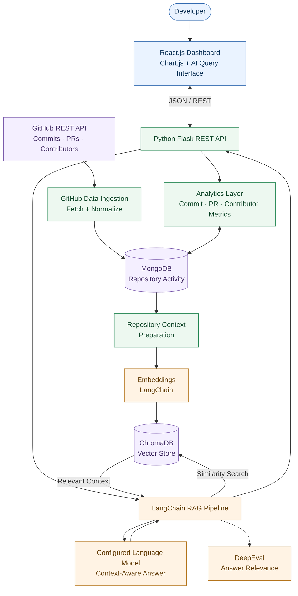
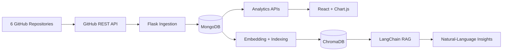
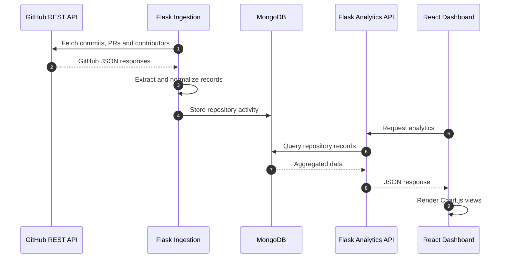
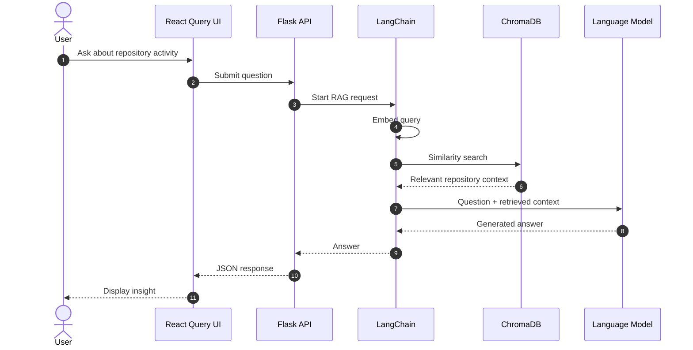
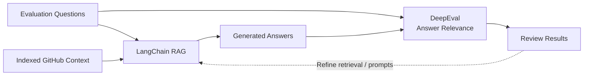

## 🛠️ Tech Stack


# 🚀 DevDynamics — AI-Powered GitHub Analytics Dashboard

### Track developer activity. Explore repository trends. Ask questions using RAG.

**Python · Flask · MongoDB · GitHub REST API · LangChain · ChromaDB · DeepEval · React.js · Chart.js**


**DevDynamics** is an individual full-stack developer analytics project that converts GitHub activity into visual insights and natural-language answers. Its **Flask REST APIs** ingest commits, pull requests, and contributor data from the **GitHub REST API**, store repository activity in **MongoDB**, and power a **React.js + Chart.js** analytics dashboard.

An additional **LangChain-based Retrieval-Augmented Generation (RAG)** pipeline uses **embeddings and ChromaDB vector search** to answer questions about repository data. **DeepEval** is used to evaluate answer relevance.

> **Project scope:** GitHub developer analytics across **6 repositories**. The README does not claim unreported accuracy scores, latency gains, or production scale.

## 🔗 Live Demo

**[Open DevDynamics](https://devdynamics-frontend.onrender.com)**

> This URL comes from the earlier DevDynamics README, which described an Angular/.NET implementation. Verify that the deployment now runs the Flask/React version before advertising it as the updated demo. Replace it if the new version has a different URL.

---

## ✨ Key Features

| Feature | Description |
|---|---|
| **GitHub data ingestion** | Collects commits, pull requests, and contributors using the GitHub REST API. |
| **Multi-repository analytics** | Provides developer activity insights across **6 tracked repositories**. |
| **Commit analytics** | Visualizes repository activity and commit trends over time. |
| **Pull request insights** | Analyzes PR activity and relevant lifecycle timestamps. |
| **Contributor insights** | Summarizes contributor participation across repositories. |
| **Interactive dashboard** | Displays analytics through **React.js** and **Chart.js**. |
| **Natural-language queries** | Lets users explore repository context by asking questions. |
| **Semantic retrieval** | Uses **LangChain**, embeddings, and **ChromaDB** for similarity search. |
| **RAG answer evaluation** | Uses **DeepEval** to evaluate how relevant answers are to questions. |

---

## 🏗️ System Architecture

The project uses two connected data paths: **structured analytics** for dashboard metrics and a **semantic retrieval pipeline** for natural-language answers.



### End-to-End Data Flow



---

## 🔄 GitHub Data Ingestion

The Flask backend gathers repository data from GitHub, prepares structured records, and stores them for analytics.

| Source | Example information | Used for |
|---|---|---|
| **Commits** | SHA, author, timestamp, repository | Activity trends and commit counts |
| **Pull requests** | PR number, state, created/merged timestamps | PR activity and lifecycle analysis |
| **Contributors** | Contributor identity and activity | Contributor insights |
| **Repositories** | Owner, name, identifying metadata | Repository-level grouping |



**Engineering consideration:** Repeated synchronization should use stable GitHub identifiers (for example, a commit SHA or repository + PR number) to avoid duplicates. Confirm the actual upsert/index behavior in the implementation.

---

## 📊 Developer Analytics Dashboard

The React frontend provides an accessible view of GitHub activity across the tracked repositories.

### Commit Trends
- Inspect commit activity over time.
- Compare activity across repositories.
- Explore contributor-linked changes where GitHub metadata is available.

### Pull Request Analytics
- Review open, closed, and merged PR activity where available.
- Examine PR lifecycle timestamps and merge trends.
- Compare repository-level PR patterns.

### Contributor Insights
- Review contributor participation and activity summaries.
- Identify changes in contribution patterns.
- Visualize repository-level developer activity.

> Commit and PR counts indicate recorded activity, **not individual developer performance or code quality**.

---

## 🧠 Natural-Language Repository Q&A (LangChain RAG)

DevDynamics adds semantic search so users can ask questions about indexed repository activity instead of relying only on charts and filters.

### RAG Workflow



**How it works:**

1. **Prepare context:** Convert useful GitHub records into text that can be retrieved.
2. **Embed:** Generate vector embeddings for repository context.
3. **Index:** Store vectors in **ChromaDB**.
4. **Retrieve:** Find relevant context for the incoming question using **LangChain**.
5. **Generate:** Provide the question and retrieved information to the configured language model.
6. **Evaluate:** Review answer relevance using **DeepEval**.

**Example questions** (illustrative):

- "Which repository had the most commit activity?"
- "Summarize recent pull request trends."
- "How does contributor activity compare across repositories?"
- "What changed in repository activity over the selected period?"

> The supplied project description does not specify an embedding model, generation model, chunking configuration, or retrieval `top_k`; those should be documented from the actual code rather than guessed.

---

## 🧪 RAG Evaluation with DeepEval

**DeepEval** is used to evaluate **answer relevance**: whether generated responses adequately address the user's repository question.



| Evaluation aspect | Purpose | Reported status |
|---|---|---|
| **Answer relevance** | Measures whether an answer addresses the question | **Evaluated using DeepEval** |
| **Retrieval usefulness** | Checks whether relevant repository context is retrieved | No metric reported |
| **Faithfulness / grounding** | Checks whether claims are supported by retrieved content | No metric reported |
| **Latency** | Measures end-to-end answer time | No benchmark reported |

No numerical DeepEval scores or performance benchmarks are asserted because none were supplied.

---

## 🛠️ Technology Stack

| Layer | Technologies |
|---|---|
| **Frontend** | React.js, Chart.js, JavaScript |
| **Backend** | Python, Flask, REST APIs |
| **GitHub Integration** | GitHub REST API |
| **Primary Data Store** | MongoDB |
| **AI Orchestration** | LangChain, Retrieval-Augmented Generation (RAG) |
| **Semantic Search** | Embeddings, ChromaDB |
| **Evaluation** | DeepEval |

---

## 🚀 Getting Started

> **Note:** The commands below assume conventional `backend/` and `frontend/` folders. Adapt folder names, environment variables, and entry points to the actual Python/React repository. The original uploaded README documented a different .NET/Angular codebase.

### Prerequisites
- Python and pip (version compatible with your installed packages)
- Node.js and npm
- MongoDB (local or hosted)
- Git
- GitHub access token, if required for your configured requests
- Credentials for the language model configured in your RAG implementation

### 1. Clone the repository

```bash
git clone <YOUR_GITHUB_REPOSITORY_URL>
cd DevDynamics
```

### 2. Start the Flask backend

```bash
cd backend
python -m venv .venv
```

**Windows PowerShell:**

```powershell
.\.venv\Scripts\Activate.ps1
```

**macOS / Linux:**

```bash
source .venv/bin/activate
```

```bash
pip install -r requirements.txt
```

Configure the variables used by your actual backend. **Example names only**:

```env
GITHUB_TOKEN=<your-github-token>
MONGODB_URI=<your-mongodb-connection-string>
CHROMA_PERSIST_DIRECTORY=./chroma_db
# Add the model-provider key expected by your LangChain integration.
```

If your application exposes `app` from `app.py`, you can start it with:

```bash
flask --app app run --debug --port 5000
```

### 3. Start the React frontend

Open a new terminal at the project root:

```bash
cd frontend
npm install
npm run dev
```

Use `npm start` instead if that is the script configured in `package.json`. For Vite projects, a common API URL setting is `VITE_API_BASE_URL=http://localhost:5000`; confirm the actual frontend configuration key.

### 4. Prepare Analytics and RAG Data

1. Configure the **6 GitHub repositories** to ingest.
2. Run the ingestion entry point included in your backend to populate MongoDB.
3. Run the indexing entry point included in your RAG implementation to populate ChromaDB.
4. Open the dashboard and test both analytics and natural-language queries.

Exact ingestion/indexing script names are intentionally omitted because the current Flask repository structure was not provided.

---

## 🔒 Security and Reliability Considerations

- Keep GitHub tokens, database credentials, and model API keys in environment variables; never commit `.env` files.
- Use GitHub API permissions appropriate to the repositories being read.
- Handle pagination, API rate limits, and partial ingestion failures.
- Validate request inputs and protect administrative actions where applicable.
- Avoid sending private repository information to external models without authorization.
- Use source records for factual metrics; treat generated text as explanatory assistance.

---

## ⚙️ Engineering Challenges

| Challenge | Approach |
|---|---|
| **Different GitHub payload formats** | Normalize commit, PR, and contributor fields. |
| **Repeated data ingestion** | Prefer stable identifiers and database upserts to avoid duplicate records. |
| **Repository-level comparisons** | Group activity by repository and timestamp. |
| **Finding relevant context for questions** | Combine LangChain embeddings with ChromaDB vector search. |
| **Irrelevant AI-generated answers** | Use DeepEval relevance checks to guide improvements. |
| **Misleading interpretations of activity** | Treat GitHub event counts as activity signals, not productivity scores. |

---

## ⚠️ Known Scope and Limitations

- Documented analytics covers **6 repositories**, without a published scalability benchmark.
- GitHub API results depend on authorization, pagination, and rate limits.
- Data freshness depends on the ingestion process and update frequency.
- Semantic search depends on the quality and freshness of indexed context.
- DeepEval answer relevance alone does **not** establish factual correctness or faithfulness.
- The earlier .NET/Angular GraphQL endpoints and Azure SQL configuration do **not** describe this Flask/MongoDB implementation.

## 🔮 Future Improvements

- Scheduled repository synchronization and better sync-status visibility.
- More analytics filters and repository comparisons.
- Source-linked answers pointing to commits and PRs.
- Additional retrieval-quality and groundedness evaluations.
- Repeatable evaluation datasets and benchmark reporting.
- More source-control providers and improved handling of large repositories.

---

## 👨‍💻 Author

**Prasad Nathe**  
Individual Project

## 📄 License

Add a `LICENSE` file to specify terms if you intend to allow open-source reuse. Publicly visible source code is not automatically licensed for reuse.
