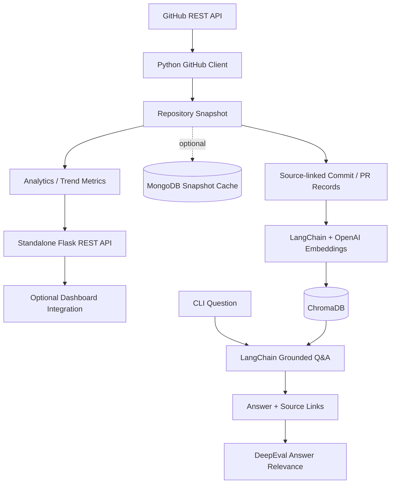

# 🐍 DevDynamics Python Analytics + AI Toolkit

**Optional, standalone extension for an existing DevDynamics dashboard.** Real Python source code for **Flask**, GitHub activity analytics, **LangChain + ChromaDB RAG**, optional **MongoDB** persistence, and **DeepEval** answer evaluation.


> **Compatibility:** This folder doesn't overwrite the existing ASP.NET Core backend, Angular/React frontend, database, deployment, environment files, or root README. No integration changes are required to upload it. It runs separately only when you choose to start it. Badges describe optional capabilities, not features automatically enabled in the old application.

## Included features

- **Flask REST endpoint** for a bounded GitHub repository activity summary.
- **GitHub REST API client** with authenticated requests, pagination caps, timeouts, input validation, and limited error disclosure.
- **Commit trends, PR merge cycle times, and contributor insights**, with partial-sync disclosure.
- **MongoDB snapshot persistence (optional)** via a standalone adapter.
- **Multi-repository Markdown report generator** for comparisons across your 6 tracked repositories.
- **LangChain + ChromaDB retrieval (optional)** using actual GitHub commits and PRs with source links.
- **Grounded answer generation (optional)** via a configured OpenAI model.
- **DeepEval evaluation (optional)** on saved, real model responses. No fabricated scores.
- **Unit and API tests** with mocked GitHub responses; tests don't need GitHub credentials.

## Architecture



## Install and start the Flask API

From the **`devdynamics-python/` folder** (Python 3.10+):

```bash
python -m venv .venv
# macOS/Linux: source .venv/bin/activate
# Windows PowerShell: .\.venv\Scripts\Activate.ps1
pip install -r requirements.txt
```

Optional: Copy `.env.example` to `.env` and set `GITHUB_TOKEN` for more generous GitHub API limits.

```bash
python -m app.api
```

Check:

- Local health check: `http://127.0.0.1:5055/health`
- Real analytics: `http://127.0.0.1:5055/api/v1/github/pallets/flask/summary?days=30`

**The API is read-only and runs on port 5055.** It does not modify the existing dashboard. GitHub data requires an internet connection. GitHub's page limit means large histories may be incomplete: inspect `is_partial` / `truncation` in results. PR data includes PRs updated in the window rather than a complete historical account.

## Fetch a reusable snapshot

```bash
python -m scripts.fetch_snapshot --repo pallets/flask --days 30 --output data/flask.json
```

The result contains GitHub commit, PR and contributor JSON with computed analytics printed in the console.

### Compare snapshots across repositories

Fetch several repositories with the same `--days` value, then compare them:

```bash
python -m scripts.fetch_snapshot --repo pallets/flask --days 30 --output data/flask.json
python -m scripts.fetch_snapshot --repo psf/requests --days 30 --output data/requests.json
python -m scripts.portfolio_report --snapshots data/flask.json data/requests.json --output data/comparison.md
```

This produces a readable Markdown comparison using actual GitHub responses. It also marks partial API results. Add additional snapshot files to compare all six repositories.

### Optional MongoDB caching

```bash
pip install -r requirements-mongo.txt
# Set MONGODB_URI in .env, then:
python -m scripts.fetch_snapshot --repo pallets/flask --days 30 --output data/flask.json --save-mongo
```

This creates/upserts a **separate `github_snapshots` collection** in the configured database; it doesn't rewrite an existing schema.

## Optional RAG with LangChain and ChromaDB

This uses OpenAI's embedding/chat APIs as an **optional provider**. It can incur usage charges; don't index private or sensitive code unless explicitly authorized.

```bash
pip install -r requirements-rag.txt
# Set OPENAI_API_KEY in .env
python -m scripts.index_repository --snapshot data/flask.json
python -m scripts.ask_repository --repo pallets/flask --question "What changed in recent commits?" --eval-output data/qa_cases.jsonl
```

Indexing builds source-linked documents from actual commits and pull requests. The code uses stable IDs to reduce duplicates on repeat indexing; text quality and API usage depend on your input.

## Optional DeepEval on real answers

```bash
pip install -r requirements-eval.txt
# Requires OPENAI_API_KEY or a compatible configured evaluator
python -m evaluation.run_deepeval --cases data/qa_cases.jsonl
# To also check factual grounding against retrieval context:
python -m evaluation.run_deepeval --cases data/qa_cases.jsonl --faithfulness
```

**DeepEval is run on generated cases** saved by the question CLI. No evaluation score is asserted until the evaluation actually executes. Model judging can incur charges.

## Test safely

```bash
python -m pytest -q
```

Tests use fake GitHub responses and run without external credentials, vector stores or LLM calls.

## Uploading via GitHub web (no terminal needed)

1. **Extract the ZIP**, and open the `devdynamics-python` folder within it.
2. In your existing GitHub repository, select **Add file → Upload files**.
3. Drag the **extracted folder** into the page if your browser supports folder upload. Otherwise, use GitHub's web editor (`.` key while on the repo) to create the same directory tree, or use Git on your computer.
4. Verify paths like `devdynamics-python/app/github_client.py`, `devdynamics-python/app/rag_pipeline.py`, `devdynamics-python/evaluation/run_deepeval.py` before committing.
5. Click **Commit changes** on the default branch.
6. Optionally copy the snippet in `BADGES_FOR_ROOT_README.md` into your root `README.md` to make the stack visible near the repository top.

**GitHub Languages:** Python `.py` source files can count toward the repository's Python percentage. Flask, LangChain, and DeepEval are libraries, not individual languages: show them with README badges and GitHub Topics instead. The relative percentage **cannot be guaranteed**, because GitHub calculates it from qualifying source-code bytes across the repository.

## Boundaries and limitations

- This package is a **separate working extension**, not proof that your existing .NET/Angular application has been migrated.
- The example Flask endpoints are not yet wired into your existing UI. That integration is optional.
- The repository and all analytics results come from live GitHub API calls (no fabricated datasets).
- Counts are limited by rate limits, the selected window, GitHub pagination, and available metadata.
- `AnswerRelevancyMetric` measures question-answer relevance, **not** guaranteed factual correctness.
- Never commit `.env`, `data/`, credentials, or personal-access tokens.
